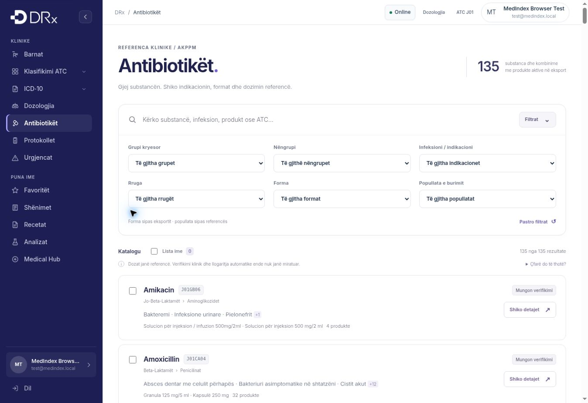

# Antibiotics catalog v2 review — 2026-11-02

## Result

Imported all 707 antibacterial / antibiotic-containing product records identified in the uploaded 4,611-record Products.xlsx export. The scope includes systemic and local antibacterials, antibiotic combinations, and nitroimidazoles with antibacterial use; standalone antifungals, antivirals and antiseptics are excluded. There are 660 Active, 34 Suspended and 13 Withdrawn records. No authorization/product/presentation identity was deduplicated away.

The native Sheet now has separate catalog, products, source indication records, controlled indication dictionary, sources, review queue, checks and instructions. A final read-back compared all nine new tabs cell-for-cell with the generated input. Original values in all five old tabs were checked unchanged; those tabs are hidden archives. Default filters exclude inactive products/contexts and nonspecific indication labels.

The website bundle contains 135 Active composition/ATC contexts, 660 products and 148 controlled condition names. The source has 528 indication-reference rows plus explicitly documented gaps. No separate substance absent from the uploaded registry is added to the display. Empty classes such as monobactams are not populated with invented products.

## Clinical boundaries

- No regimen is approved for calculation; the core always returns false for calculator approval.
- All 290 original Mayo rows retain their numerical dose, unit, interval, duration, maximum, formulation, route, original indication, population, URL and audit status.
- Nonspecific labels such as “Infeksione bakteriale” are retained for audit but do not become web filter options or named diagnoses.
- Canonical disease names share one condition ID. Source qualifiers and regimen variants remain visible separately; e.g. H. pylori dual/triple therapy is not displayed as interchangeable monotherapy.
- Reference display matches route/form context. Oral vancomycin C. difficile references do not appear as IV indications. Cream-specific mupirocin references are not assigned to ointment products. Nasal and dermatological mupirocin remain distinct.
- Powder for injection is not labeled infusion unless the original formulation says infusion. Unspecified/topical suspensions are not labeled oral.
- Source identity/ATC/form/strength ambiguities remain blocked. Twenty-five Active records have such issues. No spelling correction silently assigns a regimen to those products.
- Registration is not pharmacy stock. Import date is not an AKPPM online verification date. Foreign labels are reference sources, not Kosovo SmPC approval.
- Thirty-five Active composition/ATC contexts still lack a sufficiently specific, compatible indication reference. All local clinical approvals are missing. These gaps remain explicit and require source/clinical review; the data is not claimed clinically complete.

## Validation

Passed:

- 9 catalog unit/data tests: complete source fields, active/history isolation, controlled IDs, chemical hierarchy, combined filters, same-product route/form intersection, identity-scoped favorites, all 290 Mayo records unchanged, calculator gate, blocked conflicts, and route/form safety regressions.
- Catalog presentation contract and syntax checks for all changed JavaScript files.
- Existing Phase 2, penicillin protocols, Phase 4, Phase 5 and Phase 6 antibiotic regression suites.
- Browser inspection through the managed preview, using the repository's fictional authenticated test fixture: desktop filters, selection persistence after reload, indication/source detail, route/form/population filters together on 320px, and expanded Vancomycin detail.
- Layout at 320px and 390px: document scrollWidth equals clientWidth (305/305 and 375/375 with browser scrollbars). Tablet layout visually inspected at 768px. Mobile filters start collapsed and open to full-width controls.
- Gzip bundle size approximately 170 KB. The original navigation, branding and auth shell are retained, and no retired NICE/calculator assets are loaded.

The local Playwright integration run could not start because the pinned Chromium executable is absent from this environment. No browser-install workaround was used. The existing GitHub workflow installs Chromium/WebKit and runs the updated integration suite; those CI results must be checked before merge.

## Release boundary

This is a reference catalog and UI change. It does not approve dosing, enable automatic calculations, alter authentication, change Sheet sharing, or migrate clinical database data. The browser uses a reviewed snapshot; editing the Sheet alone does not deploy a new site version.
