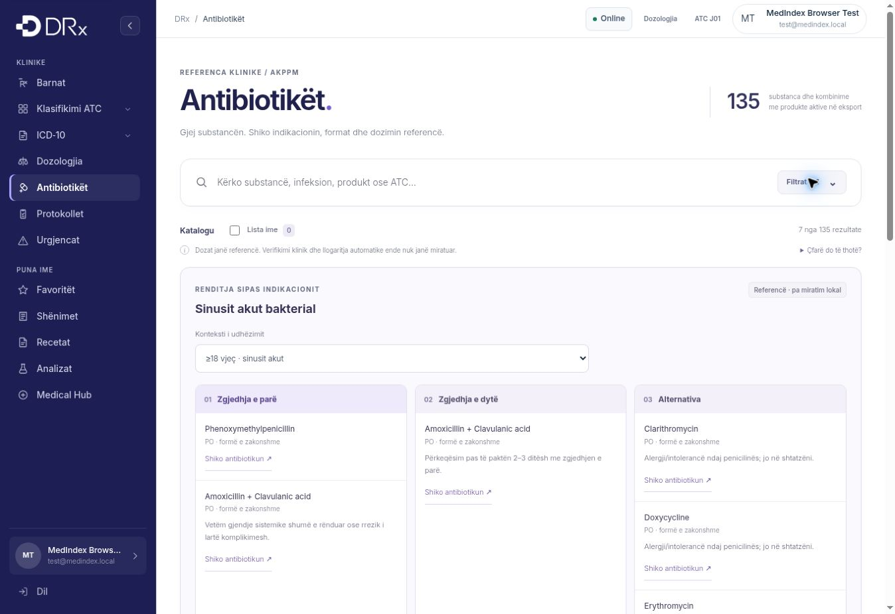

# Indication choices and individual calculator workspace — 2026-11-02

The catalog now shows source-defined first choices, second choices and conditional alternatives when an indication is selected. Context selection is required where adult and pediatric profiles differ. Seven profiles cover five controlled indication IDs: acute otitis media (1 month–17 years), acute bacterial sinusitis (adult/child), streptococcal pharyngitis and tonsillitis (adult/child), and low-severity adult/non-severe pediatric community-acquired pneumonia. This is partial, explicitly bounded coverage. Other indications display missing ranking rather than alphabetical or inferred treatment priority.

Sources are the choice tables of NICE NG91, NG79, NG84 and NG250, retrieved on 2026-11-02. Exact links, source age context and allergy, pregnancy, severity and treatment-failure conditions remain visible. Antibiotic indication is a prior clinical decision. No source dose was imported from these choice tables, and no routine second choice was fabricated for sore throat or pneumonia. First-line choices missing from the local product context are not replaced by alternatives. Legacy NICE UI/calculator assets remain unloaded.

Source records live in `antibiotiket-choices-data.js`. The browser enriches indication references for existing compatible AKPPM identities without changing their products or original Mayo regimens. The original reviewed Sheet snapshot and generated bundle remain byte-identical after regeneration. The new native Sheet tab `Renditja klinike` mirrors these choice references for review; editing the Sheet does not deploy a new build.

Every antibiotic has an individual calculator workspace with a product/strength selector, compatible Mayo regimen selector, age and weight. Drafts are separate by substance ID, stay in memory only, clear on reload and account changes, and are never persisted or transmitted by this module. No patient identifier is collected. The calculator has no arithmetic/result path: all calculations remain disabled, including where imported flags claim approval. Local product/concentration approval, a concrete condition, exact route/form and an approved source-bound regimen are still required. This implements the workspace, not clinical activation.

Validation: catalog source/safety tests and the new five-test clinical-tools suite pass locally. Tests cover bounded source contexts, no fabricated ranks, compatible identity enrichment, unchanged products/Mayo data, route/release mismatch rejection, forged approval flags and independent ephemeral drafts. Browser cases cover source-bound groups, missing second-line ranks, desktop/mobile opening, separate drafts, reload clearing, 320px layout and continued disabled calculations. CI results are recorded in the pull request before release.

Managed-browser inspection verified sinusitis choice groups, opening the corresponding antibiotic calculator, and pediatric otitis at 320px. The mobile document width and scroll width were both 305px. No horizontal overflow was observed after selecting a full product/strength label.

